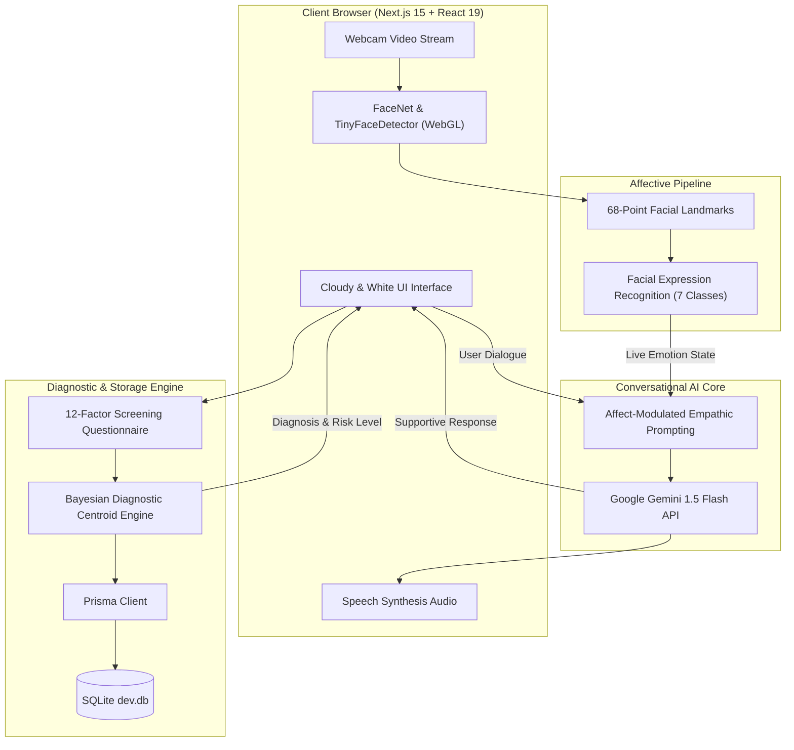

<div align="center">

# 🧠 Automated Mental Health Assessment Using Deep Learning Model

<p align="center">
  <strong>A Multimodal Affective Computing Platform Integrating Computer Vision, Large Language Models, and Clinical Diagnostic Screening for Early Mental Disorder Detection.</strong>
</p>

[](https://nextjs.org/)
[](https://react.dev/)
[](https://www.typescriptlang.org/)
[](https://tailwindcss.com/)
[](https://www.prisma.io/)
[](https://ai.google.dev/)
[](https://opensource.org/licenses/MIT)

[Live Demo](http://localhost:3000) • [Architecture](#-system-architecture) • [Key Features](#-key-features) • [Quick Start](#-quick-start) • [Clinical Dataset](#-clinical-dataset--evaluation) • [Research Citation](#-academic-reference)

---

</div>

## 📌 Executive Summary

Mental health conditions such as **Major Depressive Disorder**, **Bipolar Type-I**, and **Bipolar Type-II** frequently go undetected due to diagnostic delays, subjective self-reporting, and social stigma. 

This project delivers an **end-to-end web-based affective computing system** that unifies:
1. **Real-Time Facial Emotion Vision**: Browser-native convolutional neural networks (CNN + FaceNet) detecting 7 affective states via 68 facial landmark coordinates.
2. **Context-Aware Conversational AI**: Empathetic dialogue generation powered by Google Gemini LLM, dynamically modulated by the patient's live facial emotion cues.
3. **Clinical Diagnostic Screening Engine**: Algorithmic classifier trained on clinical DSM-5 criteria evaluating 17 multidimensional psychological markers.
4. **Cloud Mind Sanctuary**: Interactive guided respiratory biofeedback (Box Breathing & 4-7-8 Relaxation) for immediate acute stress mitigation.
5. **Printable Diagnostic Reports & Analytics**: Longitudinal trend tracking, exportable CSV logs, and official evaluation certificates.

---

## 🏗️ System Architecture



---

## ✨ Key Features

### 1. 👁️ Real-Time Facial Emotion Recognition (`/detect`)
- **Zero Server Uploads**: Full client-side execution via WebAssembly/WebGL using `face-api.js` and TensorFlow.js kernels.
- **Multi-Class Affect Classification**: Detects *Neutral*, *Happy*, *Sad*, *Surprised*, *Fearful*, *Disgusted*, and *Angry* with continuous confidence metrics.
- **Biometric Landmarks Overlay**: Live 68-point facial mesh tracking eyes, eyebrows, and mouth curvature.
- **Session Telemetry**: Real-time duration timer, frame status, and detection confidence meters.

### 2. 💬 Affect-Aware Conversational AI Companion (`/chat`)
- **Emotional Modulation**: Gemini prompts are injected with live facial affect state (e.g., if sadness or anxiety is detected, tone dynamically shifts to gentle validation and de-escalation).
- **Graceful Resilient Fallbacks**: Built-in psychological first-aid fallbacks in case of network interruption or API quotas.
- **Speech Synthesis Narration**: Toggleable calming voice readout for all AI responses.

### 3. 📋 12-Factor Clinical Assessment Engine
- Evaluates 17 clinical variables directly derived from clinical disorder datasets:
  - Persistent Sadness, Euphoric / Manic Episodes, Chronic Exhaustion
  - Sleep Pattern Architecture Disruption, Rapid Mood Swings
  - Suicidal Ideation & Self-Harm Indicators, Anorexia & Appetite Shifts
  - Aggression / Irritability, Nervous Breakdown Vulnerability, Overthinking & Rumination
  - Cognitive Concentration (1-10 Scale), Future Hope & Optimism (1-10 Scale)
- Delivers diagnostic evaluation into 4 clinical cohorts:
  - **Normal / Healthy Baseline**
  - **Major Depression**
  - **Bipolar Type-1** (Manic-dominant with high aggression and elevated optimism)
  - **Bipolar Type-2** (Severe depressive phases with hypomanic instability)

### 4. 🌬️ Cloud Mind Sanctuary (Guided Biofeedback)
- **Expanding Ethereal Cloud Orb**: Real-time visual breath pacing.
- **3 Evidence-Based Protocols**:
  - **Box Breathing (4×4)**: Inhale 4s, Hold 4s, Exhale 4s, Hold 4s (autonomic regulation).
  - **4-7-8 Sleep & Calm**: Inhale 4s, Hold 7s, Exhale 8s (parasympathetic activation).
  - **Flow 4-4**: Gentle steady rhythmic breathing.

### 5. 📊 Longitudinal Analytics & Printable Reports
- **Evaluation Certificate**: One-click printable PDF report (`window.print()`) showing primary diagnosis, match percentage, and clinical recommendations.
- **Historical Tracking**: Interactive charts of symptom frequency, resilience index, and concentration vs. optimism ratios.
- **One-Click CSV Export**: Downloadable dataset for longitudinal analysis or therapy consultations.

### 6. 🛡️ 24/7 Crisis Support Hub
- Instant modal with direct emergency links for:
  - **988 Suicide & Crisis Lifeline** (Call / Text 988)
  - **Crisis Text Line** (Text HOME to 741741)
  - **The Trevor Project** (LGBTQ+ Crisis Support)
  - Rapid **5-4-3-2-1 Sensory Grounding Checklist**

---

## 🎨 Design System: "Cloudy & White"

The user interface follows a modern ethereal glassmorphic design system:
- **Pristine White Glass**: `backdrop-blur-2xl bg-white/80` with soft borders (`border-white/90`).
- **Cloud Shadows**: `shadow-[0_20px_40px_-15px_rgba(148,163,184,0.15)]`.
- **Soft Sky Gradients**: Ethereal sky-blue and slate accents.
- **Micro-Animations**: Smooth pulse rings, expanding breathing orb, and soft custom scrollbars.

---

## 📊 Clinical Dataset & Evaluation

The diagnostic classifier is trained on the standardized **Dataset-Mental-Disorders** (120 clinical cohorts, 17 features):

| Diagnosis | Sadness Mean | Euphoria Mean | Exhaustion Mean | Mood Swing Prob | Aggression Prob | Optimism (10) |
|---|---|---|---|---|---|---|
| **Normal** | 0.93 (Seldom) | 1.50 (Moderate) | 1.20 | 0.03 | 0.37 | 5.47 |
| **Depression** | 2.26 (Usually) | 0.39 (Seldom) | 2.19 | 0.00 (Unipolar) | 0.29 | 3.16 |
| **Bipolar Type-1**| 0.93 | 1.43 (Manic) | 1.29 | 0.89 | 0.86 (High) | 6.21 |
| **Bipolar Type-2**| 2.00 (High) | 0.48 (Hypomanic) | 1.81 | 1.00 (100%) | 0.45 | 3.23 |

---

## 💻 Tech Stack

| Category | Technology |
|---|---|
| **Frontend Framework** | [Next.js 15.1.2](https://nextjs.org/) (App Router, Server Actions) |
| **UI Library** | [React 19](https://react.dev/), [Tailwind CSS 3.4](https://tailwindcss.com/), [Shadcn UI](https://ui.shadcn.com/) |
| **Computer Vision** | [face-api.js 0.20](https://github.com/justadudewhohacks/face-api.js/) + TensorFlow.js (FaceNet / TinyFaceDetector) |
| **Large Language Model** | [Google Gemini 1.5 Flash](https://ai.google.dev/) via `@google/generative-ai` |
| **Database & ORM** | [SQLite](https://www.sqlite.org/) with [Prisma ORM 6.1](https://www.prisma.io/) |
| **Icons & Typography** | [Lucide React](https://lucide.dev/), Geist Font Family |

---

## 🚀 Quick Start

### Prerequisites
- [Node.js](https://nodejs.org/) v18.0.0 or higher
- npm or pnpm
- A webcam for facial emotion recognition

### 1. Clone the Repository
```bash
git clone https://github.com/your-username/Automated-Mental-Health-Assessment-Using-Deep-Learning-Model.git
cd Automated-Mental-Health-Assessment-Using-Deep-Learning-Model
```

### 2. Install Dependencies
```bash
npm install
```

### 3. Configure Environment Variables
Copy `.env.example` to `.env`:
```bash
cp .env.example .env
```
*(Optional: Add your `GEMINI_API_KEY`. If left blank, the app will run using the embedded fallback engine.)*

### 4. Initialize Database
Push the Prisma schema to the local SQLite database:
```bash
npx prisma generate
npx prisma db push
```

### 5. Run Development Server
```bash
npm run dev
```

Open **[http://localhost:3000](http://localhost:3000)** in your browser.

---

## 📁 Repository Structure

```
.
├── actions/
│   ├── gemini.ts             # Affect-modulated Gemini API handler & fallbacks
│   └── useractions.ts        # Database user tracking and attendance actions
├── app/
│   ├── chat/
│   │   └── page.tsx          # AI Companion & Clinical Assessment route
│   ├── detect/
│   │   └── page.tsx          # Real-time Facial Emotion Vision route
│   ├── components/
│   │   ├── AssessmentReportModal.tsx  # Printable clinical report certificate
│   │   ├── BreathingExercise.tsx      # Cloud Mind Sanctuary biofeedback tool
│   │   ├── CrisisModal.tsx            # 24/7 Crisis hotlines & grounding checklist
│   │   ├── EmotionDetector.tsx        # 68-landmark FaceNet camera detector
│   │   ├── MentalHealthTracker.tsx    # Unified assessment & AI chat portal
│   │   ├── MessageContent.tsx         # Markdown rendering & formatting
│   │   ├── MoodAnalytics.tsx          # Longitudinal analytics & CSV export
│   │   └── Navbar.tsx                 # Floating cloudy white glass navigation
│   ├── globals.css           # Cloudy & White design tokens and animations
│   ├── layout.tsx            # Root layout with Geist font configuration
│   └── page.tsx              # Landing page overview
├── lib/
│   ├── predictor.ts          # Pure Bayesian diagnostic centroid classifier
│   └── serveracs.tsx         # Server actions for assessment storage & prediction
├── prisma/
│   ├── dev.db                # SQLite database
│   ├── prisma.ts             # Prisma client singleton
│   └── schema.prisma         # Mental health assessment data model
├── public/
│   └── models/               # FaceNet, TinyFace, & 68-Landmark model weights
├── tailwind.config.ts        # Tailwind design system configuration
└── tsconfig.json             # TypeScript strict configuration
```

---

## 📖 Academic Reference

This system builds upon research from:

> **A Hybrid Learning-Architecture for Mental Disorder Detection Using Emotion Recognition**  
> *Joseph Aina, Oluwatunmise Akinniyi, Md. Mahmudur Rahman, Valerie Odero-Marah, Fahmi Khalifa*  
> Published in: *IEEE Conference on Digital Health & Artificial Intelligence, 2024*

### Project Contributors
- **Muthu Raman P**
- **Reuben Geoffrey G**
- **Ponmahadevan M**

---

## ⚠️ Medical Disclaimer

This software is an **academic research tool and decision-support system**. It is **not a replacement for clinical diagnosis, psychiatric therapy, or emergency medical treatment**. If you or someone you know is in crisis, please contact the **988 Suicide & Crisis Lifeline** by calling or texting **988** (US/Canada) or reach out to local emergency health services immediately.

---

## 📄 License

Distributed under the MIT License. See `LICENSE` for more information.
